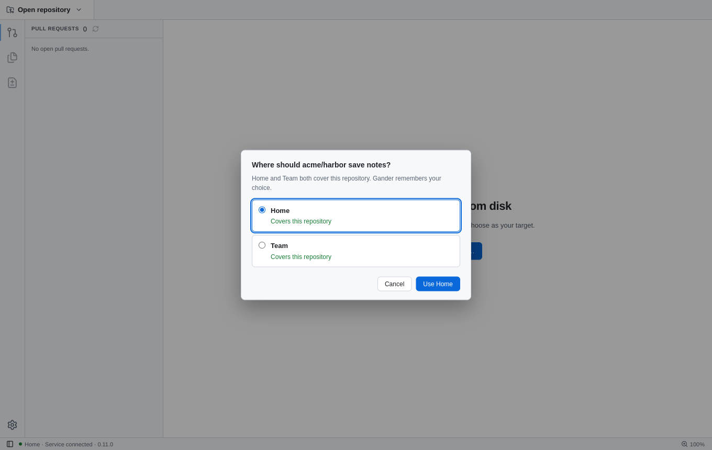
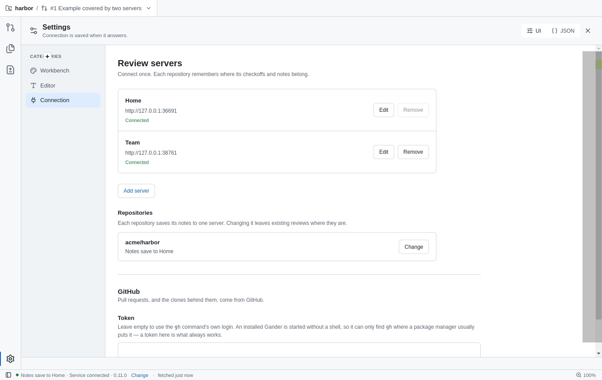
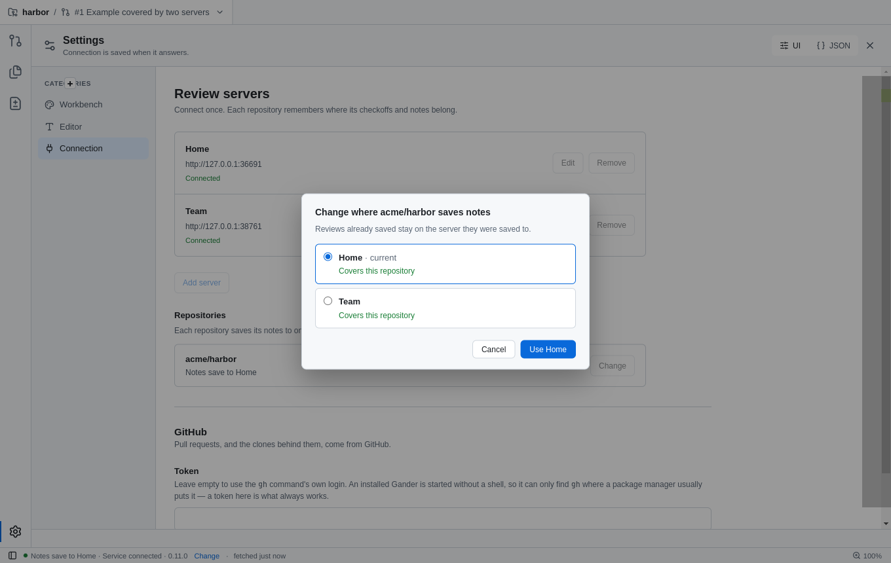
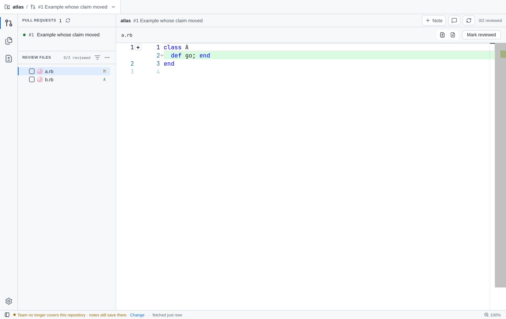

# Server claims verification

## Local desktop evidence

- `e2e/server-claims.spec.ts` runs two real Fastify services: Home covers every repository (the default for an upgraded server) and Team covers the `acme` owner. Repository names are synthetic QA data.
- Each repository is registered by the real `bin/gander` from its own checkout, the path an agent takes.
- One claimant: the repository opens on Team with no question, the checkoff lands in Team's database only, and the config records the claim.
- Two claimants: the window asks once, the answer is remembered and not asked again, and Settings → Change asks again with the current server marked.
- A claim that disappears: the status bar warns, and the repository stays on its server.
- Screenshots use Gander Light.

## Rules covered by tests

- Two claims ask; a server that cannot be reached also turns an answer into a question, because it might be a second claimant.
- A lone server keeps its repositories as before claims, unless it explicitly declines one.
- Services before contract 0.11.0 answer 404 and count as no claim; 0.9 and 0.10 stay connected.
- Claims match the full remote, so a fork goes to its own owner's server.
- Owner defaults from earlier configs become remembered choices only for repositories without a server; assigned repositories never move.
- The configured remote is the identity, not an `insteadOf` rewrite of it.

## Interaction references

- Outlook Autodiscover: the server says what it serves; the client asks only when that is ambiguous.
- gh multi-account and Git Credential Manager: one remembered account per host or remote, changeable later.
- VS Code profiles: a per-workspace choice, visible and switchable from the status bar.
