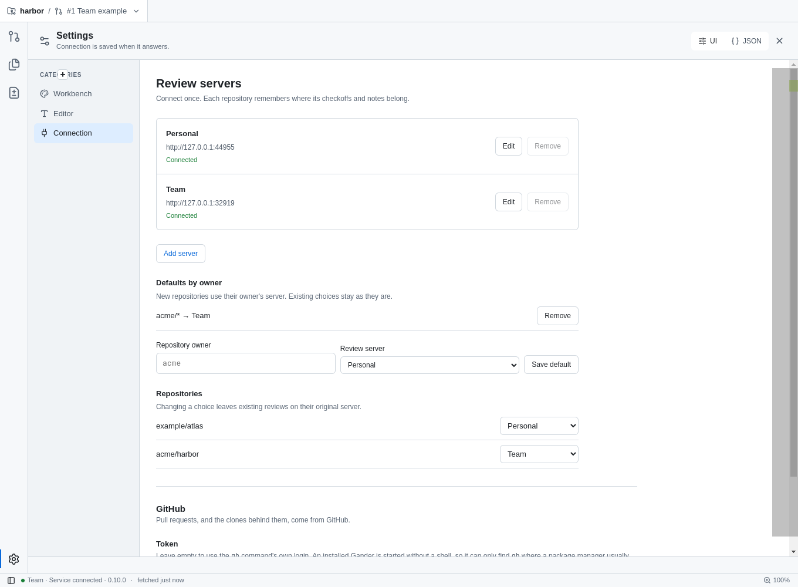
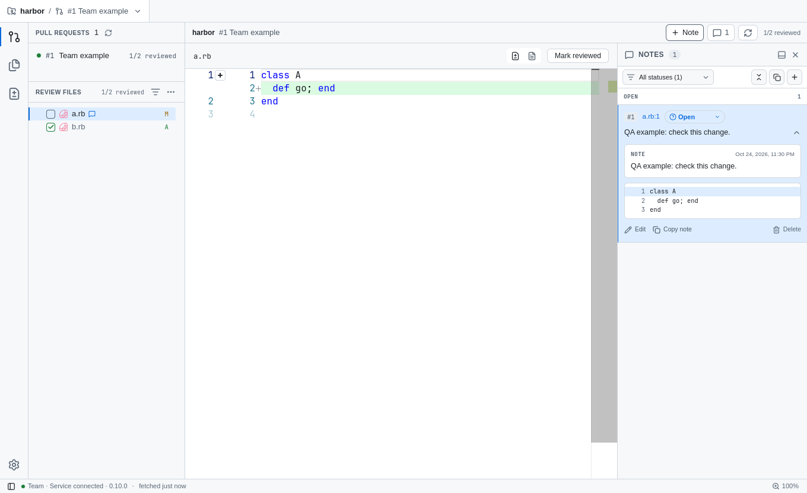

# Repository server verification

## Local desktop evidence

- The Electron scenario uses two real Fastify services with separate SQLite databases and two invented repositories.
- Checkoffs and a note are written through the desktop app; both databases are read back to verify isolation.
- Restart restores each repository's original checkoffs and server assignment.
- The screenshots use the selectable Gander Light theme. Repository names and review numbers are synthetic QA data.

## Folder checkoff measurement

- Command: `mise exec -- packages/service/node_modules/.bin/tsx bin/benchmark-checkoff.ts`.
- Environment: Linux x64, Node 24.22.0, loopback HTTP, local SQLite.
- Input: 280 files, 609,461 bytes of JSON, identical content and service for both paths.
- Single-file baseline: the previous sequential per-file algorithm, 280 requests; median 234.72 ms.
- Bulk: one request; median 83.37 ms.
- Each mode has one warmup and five measured runs. Every run reads back 280 checked files.
- Baseline samples in milliseconds: 283.77, 332.52, 234.72, 234.36, 210.36.
- Bulk samples in milliseconds: 90.70, 83.37, 140.28, 66.17, 66.44.
- This is local checkoff timing. It excludes GitHub mirror delivery and makes no production latency claim.

## Contract boundaries

- Contract 0.10.0 uses atomic bulk writes, at most 500 files and 16 MiB per request.
- Contract 0.9 uses the existing single-file route on the same assigned server.
- Failures never redirect a review to another server or retry a rejected bulk write as single-file writes.
- Targeted tests cover transaction rollback, note states, retained snapshots, validation, body limits, batching and migration.

## Review and validation

- Targeted validation passes: 207 unit tests in 23 affected files, typecheck, and 13 affected Electron scenarios.
- The desktop test also gives notes the same numeric ID on two servers, changes the repository assignment, and verifies that the old server session cannot edit the other server's note.
- A fresh independent reviewer found two concurrency defects: delayed responses crossing server assignments and registration into a replaced config array. Both have regression coverage; a second fresh review reports no blocking findings.
- The local evidence does not cover hosted service deployment or upgrades on another machine.

## Interaction references

- [Tower connected accounts](https://www.git-tower.com/help/guides/manage-hosting-services/connect-accounts/windows) keeps named connections available together.
- [VS Code account preferences](https://code.visualstudio.com/updates/v1_95#_multiple-github-accounts) remembers account choices for the workspace. Gander applies that pattern to each repository.
