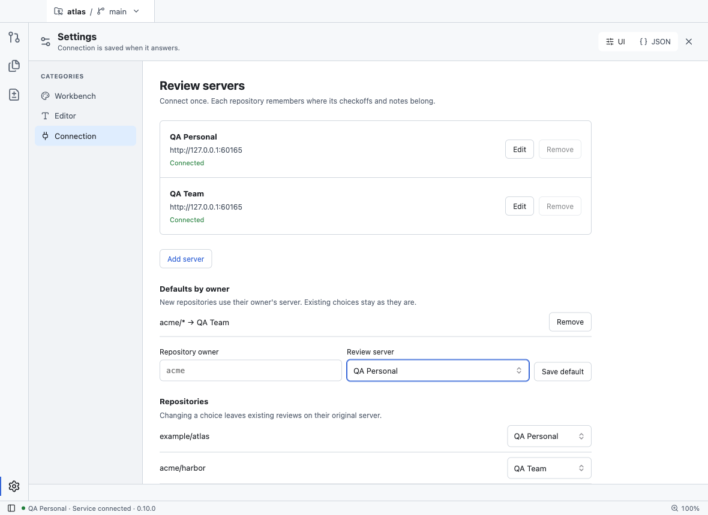
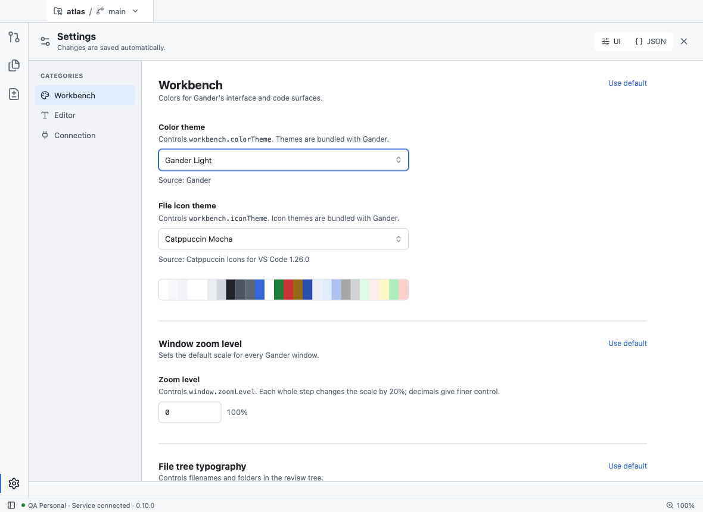
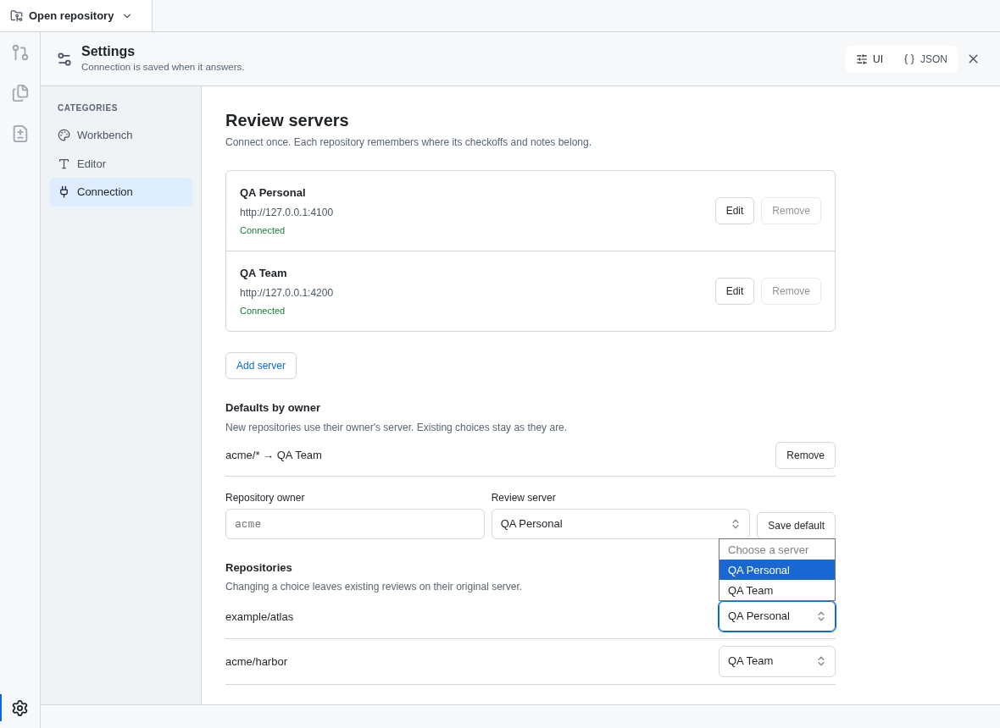

# Settings dropdown verification

- `packages/app/e2e/settings-controls.spec.ts` writes these screenshots on macOS in the Gander Light theme. Servers and repositories are synthetic QA data.
- Every settings dropdown is drawn as the macOS pop-up button: rounded box, up-and-down chevron, one accent focus ring.
- The spec fails while any settings dropdown keeps Chromium's own control or stacks a second focus outline.
- The open list is a native macOS menu and does not appear in a window screenshot. `connection-open.png` is the built renderer in headless Chromium on Linux with a stand-in preload bridge, where Chromium draws the list itself; it shows the drawn control and ring with the list open, not the macOS menu.

